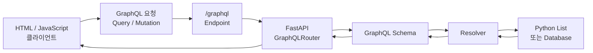
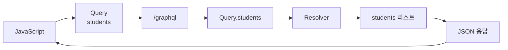
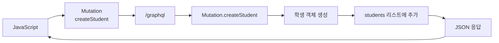
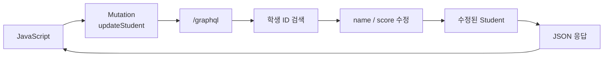
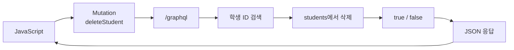
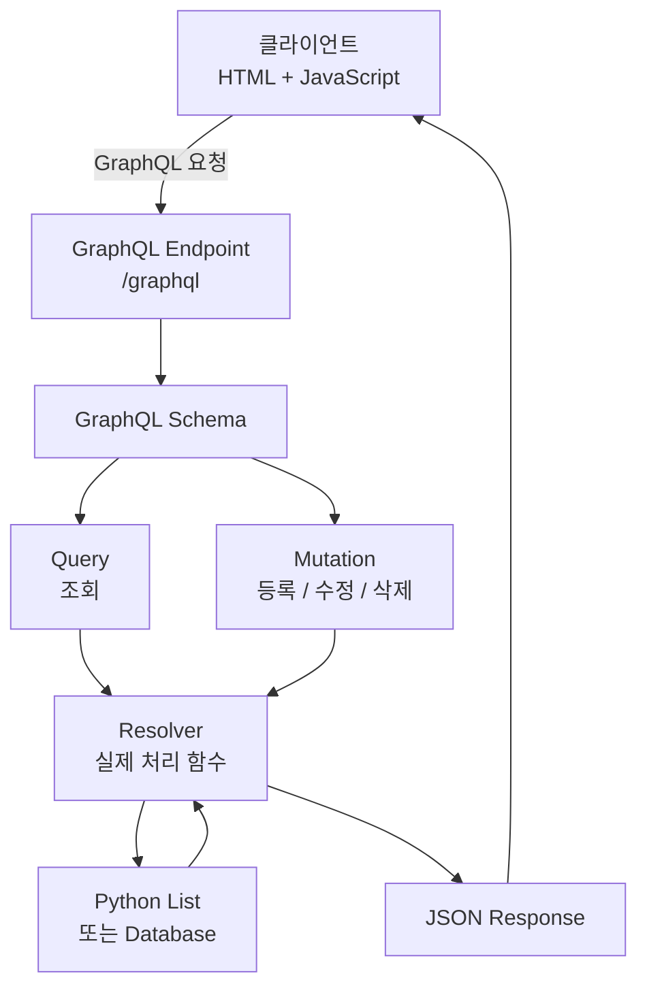

# GraphQL의 CRUD 구조

구성은 다음과 같습니다.

- 서버: `FastAPI + Strawberry GraphQL`
- 데이터베이스 대신: Python 리스트 사용
- 클라이언트: HTML + JavaScript `fetch()`
- 기능:
  - Create: 학생 추가
  - Read: 학생 전체 조회
  - Update: 학생 수정
  - Delete: 학생 삭제

---

# 1. 전체 구조

```text
[HTML + JavaScript]
        |
        | GraphQL Query / Mutation
        v
[FastAPI + Strawberry]
        |
        | Python List
        v
     학생 데이터
```

GraphQL에서는 REST처럼 URL을 여러 개 만들기보다 보통 하나의 주소를 사용합니다.

```text
http://127.0.0.1:8000/graphql
```

대신 요청 내용으로 작업을 구분합니다.

```text
조회     → Query
등록     → Mutation
수정     → Mutation
삭제     → Mutation
```

---

# 2. 설치

```bash
pip install fastapi uvicorn strawberry-graphql
```

---

# 3. 서버 코드

파일명:

```text
server.py
```

```python
from typing import List, Optional

import strawberry
from fastapi import FastAPI
from fastapi.middleware.cors import CORSMiddleware
from strawberry.fastapi import GraphQLRouter


# --------------------------------
# 1. 학생 타입
# --------------------------------
@strawberry.type
class Student:
    id: int
    name: str
    score: int


# --------------------------------
# 2. 임시 데이터
# --------------------------------
students = [
    Student(id=1, name="홍길동", score=90),
    Student(id=2, name="김철수", score=85),
]


# --------------------------------
# 3. Query = 조회
# --------------------------------
@strawberry.type
class Query:

    @strawberry.field
    def students(self) -> List[Student]:
        return students


# --------------------------------
# 4. Mutation = 등록/수정/삭제
# --------------------------------
@strawberry.type
class Mutation:

    # CREATE
    @strawberry.mutation
    def create_student(
        self,
        name: str,
        score: int
    ) -> Student:

        new_id = max([s.id for s in students], default=0) + 1

        student = Student(
            id=new_id,
            name=name,
            score=score
        )

        students.append(student)

        return student


    # UPDATE
    @strawberry.mutation
    def update_student(
        self,
        id: int,
        name: str,
        score: int
    ) -> Optional[Student]:

        for student in students:

            if student.id == id:

                student.name = name
                student.score = score

                return student

        return None


    # DELETE
    @strawberry.mutation
    def delete_student(
        self,
        id: int
    ) -> bool:

        for student in students:

            if student.id == id:

                students.remove(student)

                return True

        return False


# --------------------------------
# 5. GraphQL Schema
# --------------------------------
schema = strawberry.Schema(
    query=Query,
    mutation=Mutation
)


# --------------------------------
# 6. FastAPI
# --------------------------------
app = FastAPI()


# CORS
app.add_middleware(
    CORSMiddleware,
    allow_origins=["*"],
    allow_methods=["*"],
    allow_headers=["*"],
)


graphql_app = GraphQLRouter(schema)


app.include_router(
    graphql_app,
    prefix="/graphql"
)
```

---

# 4. 서버 실행

```bash
uvicorn server:app --reload
```

브라우저에서:

```text
http://127.0.0.1:8000/graphql
```

로 접속하면 GraphQL 테스트 화면을 사용할 수 있습니다.

---

# 5. Read - 전체 조회

GraphQL에서 조회는 `Query`를 사용합니다.

```graphql
query {
  students {
    id
    name
    score
  }
}
```

응답:

```json
{
  "data": {
    "students": [
      {
        "id": 1,
        "name": "홍길동",
        "score": 90
      },
      {
        "id": 2,
        "name": "김철수",
        "score": 85
      }
    ]
  }
}
```

GraphQL의 특징은 필요한 필드만 요청할 수 있다는 것입니다.

예를 들어 이름만 필요하면:

```graphql
query {
  students {
    name
  }
}
```

응답도 이름만 옵니다.

```json
{
  "data": {
    "students": [
      {
        "name": "홍길동"
      },
      {
        "name": "김철수"
      }
    ]
  }
}
```

---

# 6. Create - 학생 등록

등록은 `Mutation`을 사용합니다.

```graphql
mutation {
  createStudent(
    name: "이영희"
    score: 95
  ) {
    id
    name
    score
  }
}
```

응답:

```json
{
  "data": {
    "createStudent": {
      "id": 3,
      "name": "이영희",
      "score": 95
    }
  }
}
```

---

# 7. Update - 학생 수정

```graphql
mutation {
  updateStudent(
    id: 1
    name: "홍길동"
    score: 100
  ) {
    id
    name
    score
  }
}
```

---

# 8. Delete - 학생 삭제

```graphql
mutation {
  deleteStudent(id: 2)
}
```

응답:

```json
{
  "data": {
    "deleteStudent": true
  }
}
```

---

# 9. 클라이언트 코드

이번에는 HTML과 JavaScript에서 GraphQL 서버를 호출해보겠습니다.

파일명:

```text
index.html
```

```html
<!DOCTYPE html>
<html lang="ko">

<head>
    <meta charset="UTF-8">

    <title>GraphQL CRUD</title>
</head>

<body>

<h1>학생 관리</h1>


<h2>학생 등록</h2>

이름:
<input id="name">

점수:
<input id="score" type="number">

<button onclick="createStudent()">
    등록
</button>


<hr>


<h2>학생 목록</h2>

<button onclick="loadStudents()">
    조회
</button>

<ul id="studentList"></ul>


<script>

const URL = "http://127.0.0.1:8000/graphql";


// --------------------------------
// GraphQL 요청 공통 함수
// --------------------------------
async function graphqlRequest(query) {

    const response = await fetch(URL, {

        method: "POST",

        headers: {
            "Content-Type": "application/json"
        },

        body: JSON.stringify({
            query: query
        })

    });

    return await response.json();
}


// --------------------------------
// READ
// --------------------------------
async function loadStudents() {

    const query = `
        query {

            students {

                id
                name
                score

            }

        }
    `;

    const result = await graphqlRequest(query);

    const students = result.data.students;


    const list = document.querySelector("#studentList");

    list.innerHTML = "";


    students.forEach(student => {

        const li = document.createElement("li");

        li.innerHTML = `
            ${student.id}
            ${student.name}
            ${student.score}

            <button onclick="
                updateStudent(${student.id})
            ">
                수정
            </button>

            <button onclick="
                deleteStudent(${student.id})
            ">
                삭제
            </button>
        `;

        list.appendChild(li);

    });

}


// --------------------------------
// CREATE
// --------------------------------
async function createStudent() {

    const name =
        document.querySelector("#name").value;

    const score =
        Number(
            document.querySelector("#score").value
        );


    const query = `
        mutation {

            createStudent(
                name: "${name}"
                score: ${score}
            ) {

                id
                name
                score

            }

        }
    `;


    await graphqlRequest(query);

    loadStudents();

}


// --------------------------------
// UPDATE
// --------------------------------
async function updateStudent(id) {

    const name =
        prompt("수정할 이름");

    const score =
        Number(
            prompt("수정할 점수")
        );


    const query = `
        mutation {

            updateStudent(
                id: ${id}
                name: "${name}"
                score: ${score}
            ) {

                id
                name
                score

            }

        }
    `;


    await graphqlRequest(query);

    loadStudents();

}


// --------------------------------
// DELETE
// --------------------------------
async function deleteStudent(id) {

    const query = `
        mutation {

            deleteStudent(
                id: ${id}
            )

        }
    `;


    await graphqlRequest(query);

    loadStudents();

}


loadStudents();

</script>

</body>
</html>
```

---

# 10. 핵심은 이 부분입니다

클라이언트는 GraphQL 서버에 항상 같은 주소로 요청합니다.

```javascript
const URL = "http://127.0.0.1:8000/graphql";
```

REST라면 보통 다음처럼 URL이 여러 개가 됩니다.

```text
GET    /students
POST   /students
PUT    /students/1
DELETE /students/1
```

GraphQL은 보통:

```text
POST /graphql
```

하나를 사용합니다.

대신 요청 내용을 바꿉니다.

```graphql
query
```

또는:

```graphql
mutation
```

---

# 11. REST와 GraphQL의 CRUD 비교

| CRUD | REST | GraphQL |
|---|---|---|
| 조회 | GET | Query |
| 등록 | POST | Mutation |
| 수정 | PUT/PATCH | Mutation |
| 삭제 | DELETE | Mutation |

GraphQL에서는 `POST`, `PUT`, `DELETE` 같은 HTTP 메서드가 CRUD의 핵심이 아닙니다.

핵심은:

```text
조회
  ↓
Query
```

```text
변경
  ↓
Mutation
```

입니다.

---

# 12. 전체 흐름

```mermaid
flowchart LR

A[HTML / JavaScript]

B[GraphQL Query 또는 Mutation]

C[/graphql]

D[FastAPI]

E[GraphQL Schema]

F[Resolver]

G[Python List 또는 DB]

A --> B
B --> C
C --> D
D --> E
E --> F
F --> G

G --> F
F --> E
E --> D
D --> A
```

GraphQL을 처음 설명할 때는 이 관계를 이해시키는 것이 가장 중요합니다.

```text
클라이언트
    ↓
Query / Mutation
    ↓
GraphQL Schema
    ↓
Resolver
    ↓
DB
```

그리고 결과는 반대로:

```text
DB
 ↓
Resolver
 ↓
GraphQL
 ↓
JSON
 ↓
클라이언트
```

로 돌아옵니다.

특히 **Schema는 "무엇을 요청할 수 있는지 정의"하고, Resolver는 "그 요청을 실제 Python 코드나 DB 작업으로 연결한다"**고 설명하면 학생들이 GraphQL 구조를 훨씬 쉽게 이해합니다.

## 12. GraphQL CRUD 전체 흐름

### 12.1 전체 구조



핵심 흐름은 다음과 같습니다.

```text
클라이언트
   ↓
GraphQL Query / Mutation
   ↓
/graphql
   ↓
FastAPI + GraphQLRouter
   ↓
Schema
   ↓
Resolver
   ↓
Python List 또는 DB
```

처리 결과는 반대 방향으로 돌아갑니다.

```text
Python List / DB
       ↓
    Resolver
       ↓
     Schema
       ↓
 GraphQL Server
       ↓
      JSON
       ↓
   클라이언트
```

---

## 12.2 조회(Read) 흐름

학생 목록 조회를 예로 들면 다음과 같습니다.

클라이언트 요청:

```graphql
query {
  students {
    id
    name
    score
  }
}
```

전체 처리 과정:



서버에서는 이 부분이 실행됩니다.

```python
@strawberry.type
class Query:

    @strawberry.field
    def students(self) -> list[Student]:
        return students
```

즉,

```text
students 요청
     ↓
Query.students()
     ↓
Python students 리스트
     ↓
JSON 변환
     ↓
클라이언트
```

입니다.

---

## 12.3 등록(Create) 흐름

클라이언트:

```graphql
mutation {
  createStudent(
    name: "이영희"
    score: 95
  ) {
    id
    name
    score
  }
}
```

처리 흐름:



서버에서는:

```python
@strawberry.mutation
def create_student(
    self,
    name: str,
    score: int
) -> Student:

    new_id = max(
        [student.id for student in students],
        default=0
    ) + 1

    student = Student(
        id=new_id,
        name=name,
        score=score
    )

    students.append(student)

    return student
```

따라서:

```text
createStudent
      ↓
Mutation
      ↓
새 Student 생성
      ↓
students.append()
      ↓
생성된 Student 반환
      ↓
JSON 응답
```

입니다.

---

## 12.4 수정(Update) 흐름

요청:

```graphql
mutation {
  updateStudent(
    id: 1
    name: "홍길동"
    score: 100
  ) {
    id
    name
    score
  }
}
```

처리 흐름:



핵심은:

```text
ID = 1 학생 찾기
      ↓
name 수정
score 수정
      ↓
수정된 객체 반환
```

입니다.

---

## 12.5 삭제(Delete) 흐름

요청:

```graphql
mutation {
  deleteStudent(id: 2)
}
```

처리 흐름:



서버의 결과가:

```python
return True
```

이면 응답은 대략 다음과 같습니다.

```json
{
  "data": {
    "deleteStudent": true
  }
}
```

---

# 12.6 CRUD 전체를 한 그림으로 정리

강의에서는 이 그림이 가장 이해하기 쉽습니다.



### 이 그림에서 가장 중요한 개념

GraphQL을 가르칠 때는 다음 네 가지를 연결해서 설명하면 됩니다.

```text
① Endpoint
      ↓
② Schema
      ↓
③ Query / Mutation
      ↓
④ Resolver
      ↓
⑤ Database
```

각 역할은 다음과 같습니다.

| 구성요소 | 역할 |
|---|---|
| `/graphql` | GraphQL 요청을 받는 주소 |
| Schema | 어떤 요청을 허용할지 정의 |
| Query | 데이터 조회 |
| Mutation | 데이터 등록·수정·삭제 |
| Resolver | 실제 Python 처리 코드 |
| DB/List | 실제 데이터 저장 장소 |
| JSON Response | 클라이언트에게 반환되는 결과 |

특히 **Schema와 Resolver의 차이**를 분명히 하는 것이 중요합니다.

```text
Schema
"무엇을 요청할 수 있는가?"
```

예:

```graphql
students {
    id
    name
    score
}
```

반면 Resolver는:

```text
Resolver
"그 요청을 실제로 어떻게 처리할 것인가?"
```

입니다.

예:

```python
def students(self):
    return students
```

따라서 학생들에게는 GraphQL을 다음 한 줄로 설명하면 구조가 잘 잡힙니다.

> **클라이언트가 Query 또는 Mutation을 `/graphql`로 보내면, Schema가 요청을 확인하고 Resolver가 실제 데이터를 처리한 뒤 필요한 결과만 JSON으로 반환한다.**
